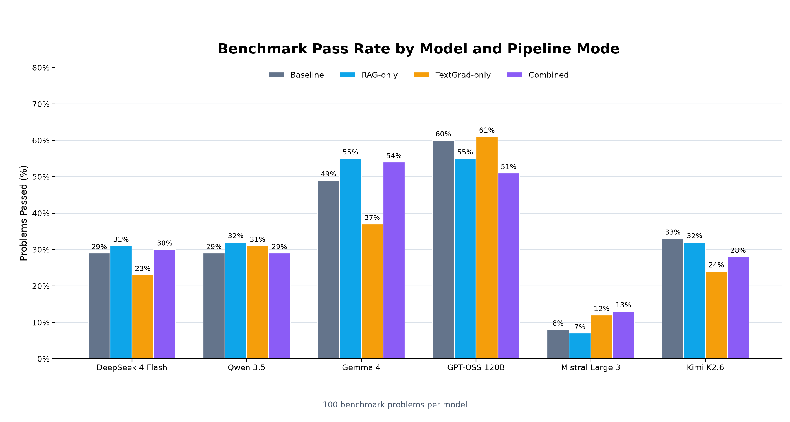
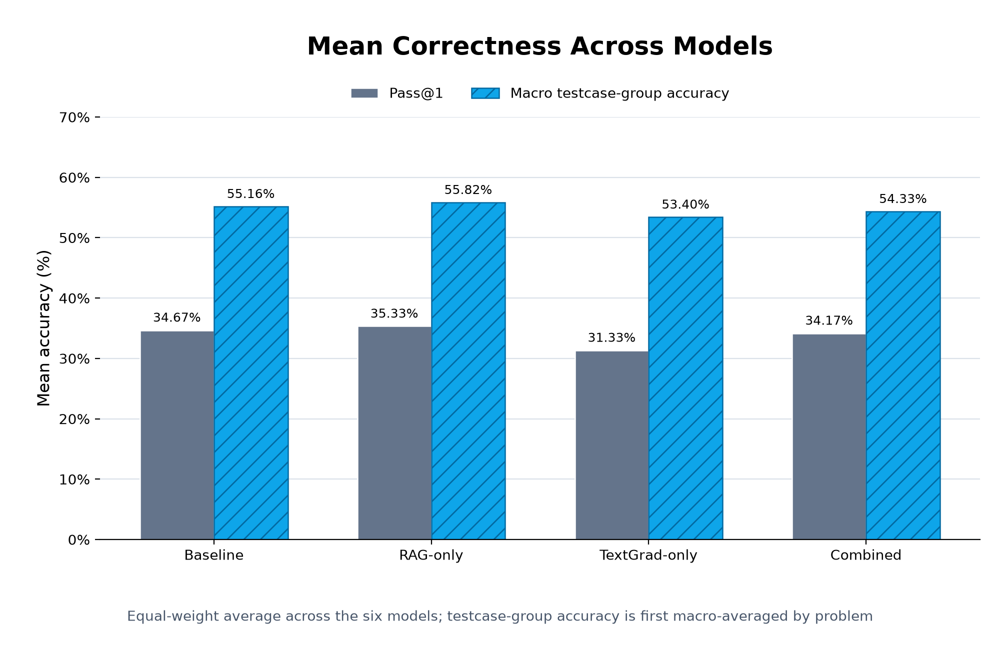
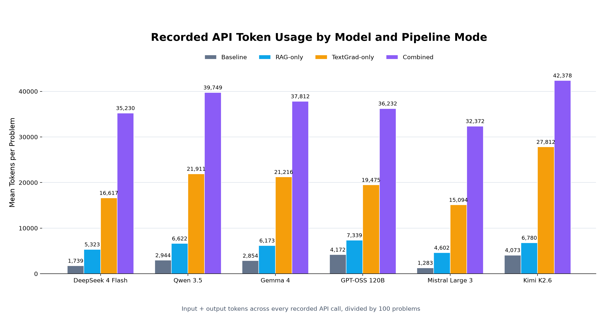

# Competitive Programming LLM Evaluation Platform

> **Project status: Completed**

This final-year project investigates whether retrieval-augmented generation (RAG) and TextGrad-based prompt optimisation improve Python solutions to hard competitive-programming problems. It provides a browser-based chat and benchmark platform backed by FastAPI, ChromaDB, configurable local or remote language models, and a LiveCodeBench evaluation pipeline.

The completed evaluation tested six LLMs on 100 hard problems under four configurations:

- **Baseline** - direct solution generation.
- **RAG-only** - generation with retrieved competitive-programming context.
- **TextGrad-only** - critic-guided prompt refinement and regeneration.
- **Combined** - RAG followed by TextGrad refinement.

The principal findings and the final evaluation figures are summarised below. All report graphs are stored together in [`report/figures/`](report/figures/).

## Final results

| Configuration | Mean Pass@1 | Mean macro testcase-group accuracy | Mean tokens per problem | Relative token use |
|---|---:|---:|---:|---:|
| Baseline | 34.67% | 55.16% | 2,844 | 1.00x |
| RAG-only | **35.33%** | **55.82%** | 6,140 | 2.16x |
| TextGrad-only | 31.33% | 53.40% | 20,354 | 7.16x |
| Combined | 34.17% | 54.33% | 37,295 | 13.11x |

RAG produced a small average improvement but was not consistently beneficial across models: it fixed 57 Baseline failures while regressing 53 Baseline successes. TextGrad did not improve mean correctness in the tested configuration, and combining both methods did not produce additive gains. The results favour a conditional pipeline that validates retrieved context and preserves the original candidate unless an enhanced candidate demonstrates an improvement.



*Pass@1 across the six evaluated models and four pipeline configurations.*



*Mean Pass@1 and macro testcase-group accuracy across all six models.*

The additional inference stages had a substantial cost: Combined used 13.11 times the Baseline tokens without exceeding Baseline correctness.



*Mean recorded input and output tokens per problem.*

## Completed functionality

- Streaming chat through FastAPI WebSockets.
- Local Ollama models and configured remote model providers.
- Persistent ChromaDB retrieval with source metadata and RAG context display.
- End-to-end RAG construction: scrape, normalise, chunk, embed, index, and reload.
- Optional TextGrad refinement for interactive and benchmark generations.
- LiveCodeBench download, readiness validation, background execution, cancellation, progress reporting, and result persistence.
- Baseline, RAG-only, TextGrad-only, and Combined benchmark comparisons.
- Pass@1, testcase-group accuracy, transition, token, latency, truncation, and compliance analysis.
- Docker Compose deployment for the Nginx frontend and FastAPI backend.

## Architecture

```text
Browser UI (Nginx or FastAPI static files)
    -> FastAPI HTTP/WebSocket endpoints
        -> solver pipeline
            -> optional ChromaDB retrieval
            -> initial model generation
            -> optional TextGrad critic and refinement
            -> LiveCodeBench evaluation and saved results
```

The RAG knowledge base is built from Codeforces, USACO, AtCoder, CP-Algorithms, and the *Competitive Programmer's Handbook*. Source records are normalised and chunked before being embedded with `BAAI/bge-small-en-v1.5` and stored in the local `cp_rag` ChromaDB collection.

## Project structure

```text
FYP/
|-- README.md
|-- Dockerfile                     Python backend image
|-- docker-compose.yaml            Frontend/backend stack
|-- requirements.txt               Python dependencies
|-- report/
|   `-- figures/                   Final evaluation graphs
|-- public/                        Static browser interface
`-- backend/
    |-- main.py                    FastAPI application and RAG build orchestration
    |-- solver.py                  Generation and evaluation workflow
    |-- TextGrad.py                TextGrad refinement integration
    |-- llm_clients.py             Local and remote model clients
    |-- rag_handler.py             ChromaDB loading and retrieval
    |-- RAG/                       Scrapers and index-building pipeline
    |-- benchmark/                 Runner, metrics, plot generator, and data loading
    |-- lcb_runner/                LiveCodeBench evaluation utilities
    |-- routes/                    Benchmark API routes
    `-- tests/                     Backend and RAG regression tests
```

`backend/data/` and `logs/` are runtime locations and may be absent from a fresh checkout. They are created when the corresponding workflows run.

## Prerequisites

The recommended setup requires:

- Docker Desktop using Linux containers (WSL 2 backend on Windows).
- Git, if the repository still needs to be cloned.
- Either a local [Ollama](https://ollama.com/) installation with at least one pulled model, or credentials for a supported remote model provider.

Internet access is required for the initial image build, model and dataset downloads, source scraping, and remote model calls. Benchmark evaluation executes model-generated code; use Docker or another appropriately isolated Linux environment.

## Run with Docker

From the repository root:

```bash
docker compose up --build
```

Then open:

- Frontend: <http://localhost:3000>
- Backend API documentation: <http://localhost:5050/docs>

The backend bind-mounts the repository at `/workspace`, allowing downloaded datasets, RAG artifacts, and benchmark results to persist on the host. A host Ollama instance is reached through `host.docker.internal:11434`.

## Build the RAG knowledge base

Use **Settings -> Build RAG knowledge base** in the UI, or run:

```bash
python -m backend.RAG.main \
  --data-root backend/data \
  --embedder local \
  --vector-db chroma
```

Useful alternatives:

```bash
# Reprocess saved source data without scraping
python -m backend.RAG.main --data-root backend/data --pipeline-only --embedder local --vector-db chroma

# Build selected sources only
python -m backend.RAG.main --data-root backend/data --sources codeforces,cp_algorithms --embedder local --vector-db chroma
```

Supported source names are `codeforces`, `usaco`, `atcoder`, `cp_algorithms`, and `cph`.

## Run a benchmark

1. Download the selected LiveCodeBench release from **Settings**.
2. Build the RAG knowledge base if RAG configurations will be evaluated.
3. Configure the initial and TextGrad models and any required API keys.
4. Open **Benchmark**, confirm the readiness checks, and start the run.
5. Monitor progress and inspect the persisted summaries and per-test-case records under `logs/`.

The final report used 100 hard problems from LiveCodeBench `release_v6` with seed 42. Full benchmark execution depends on POSIX process controls and should be run in the Linux Docker container or under WSL, not directly with Windows Python.

## Reproduce the evaluation graphs

The plot generator reads the selected benchmark result files from `backend/benchmark/results/` and writes the final graph set to `report/figures/`:

```bash
python backend/benchmark/plot_results.py
```

To use a different result directory or primary output path:

```bash
python backend/benchmark/plot_results.py \
  --results-dir path/to/results \
  --output path/to/figures/benchmark_results.png
```

Related graphs are written beside the specified `--output` file. The generator produces only the 11 figures retained for the completed evaluation.

## Local development

Python 3.11 is the target runtime. On Windows PowerShell:

```powershell
python -m venv .venv
.venv\Scripts\Activate.ps1
pip install torch --index-url https://download.pytorch.org/whl/cpu
pip install -r requirements.txt
$env:PYTHONPATH = "$PWD\backend"
uvicorn backend.main:app --host 127.0.0.1 --port 5050 --reload
```

Open <http://127.0.0.1:5050/>. Host-native Windows supports UI, chat, model access, and RAG development, but not the POSIX-based LiveCodeBench evaluator.

## Tests

From the repository root:

```powershell
$env:PYTHONPATH = "$PWD\backend;$PWD"
python -m pytest backend/tests
```

Some tests use local RAG data or evaluation subprocesses and may take longer than unit tests.

## Main endpoints

| Method | Path | Purpose |
|---|---|---|
| `GET` | `/api/status` | Backend health |
| `GET` | `/api/defaults` | Model and settings defaults |
| `GET` | `/api/ollama/status` | Local Ollama status |
| `POST` | `/api/chat` | Non-streaming generation |
| WebSocket | `/ws/chat` | Streaming chat and TextGrad events |
| `POST` | `/api/rag/build` | Start the scrape-to-index RAG build |
| `GET` | `/api/rag/build/status` | RAG build progress |
| `POST` | `/benchmark/dataset/download` | Cache a LiveCodeBench release |
| `POST` | `/benchmark/readiness` | Validate benchmark prerequisites |
| `POST` | `/benchmark/run` | Start a benchmark |
| `POST` | `/benchmark/stop` | Request cancellation |
| `GET` | `/benchmark/status` | Benchmark progress |
| `GET` | `/benchmark/results` | Latest persisted results |

## Scope and limitations

The reported findings are specific to one generation per model/problem/configuration, six selected models, 100 hard problems, and one TextGrad setup. The benchmark sample was platform-imbalanced, and four evaluated problems retrieved content with the same problem identifier, creating a contamination risk. Token counts are a provider-independent computational-cost proxy rather than monetary costs.

## Data and licensing

This repository is intended for research and educational use. Upstream content retains its original ownership and licensing. The *Competitive Programmer's Handbook* material is identified as CC BY-NC-SA 4.0. Verify each source's terms before redistributing a generated corpus or vector index.
